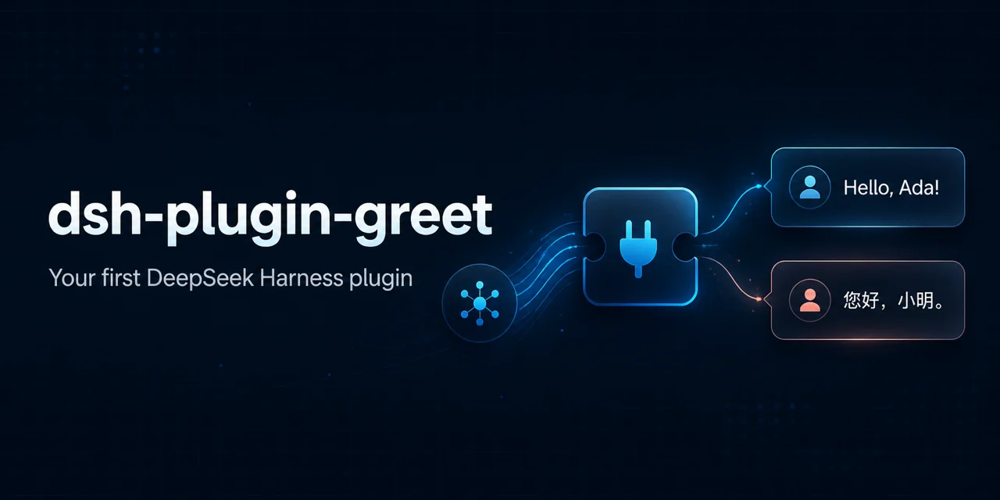
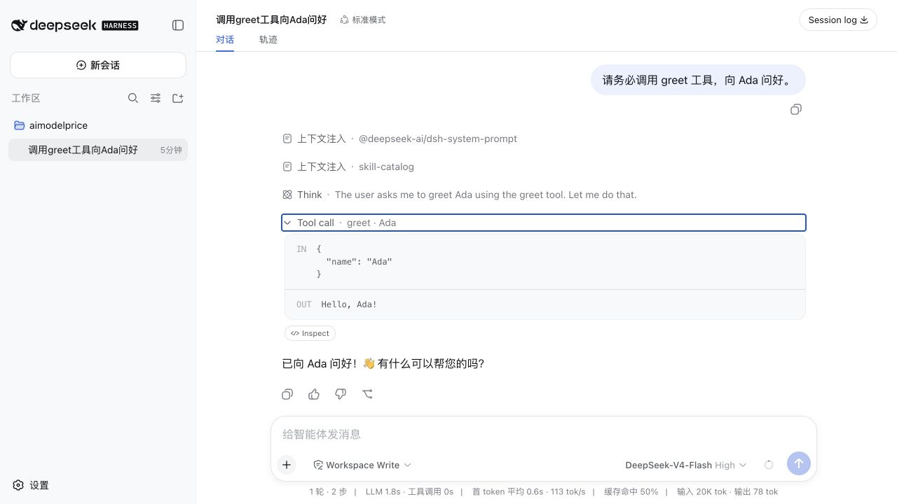

<p align="center">
  
</p>

# dsh-plugin-greet

English | [简体中文](docs/README.zh-CN.md)

A beginner-friendly, installable DeepSeek Harness plugin that demonstrates bundle distribution, profile composition, plugin configuration, the typed `defineTool()` API, structured output, validation, testing, and a real model-driven tool call.

> This is a community example, not an official DeepSeek AI plugin. DeepSeek Harness is currently in Developer Preview, so future releases may require compatibility updates.



## What you will learn

This repository keeps the implementation in one small entry file so that a new plugin author can follow the complete path:

```text
User prompt
  → model chooses the greet tool
  → argument schema checks the shape
  → execute validates and normalizes values
  → the tool returns structured data
  → output.render creates model-facing text
  → the model writes its final response
```

The example covers:

- exporting a validated plugin `Config`
- injecting and using the Harness `tools` service
- registering a tool with the current `defineTool()` schema DSL
- required and optional tool arguments
- English and Chinese greetings
- friendly and formal styles
- structured canonical output with a text renderer
- actionable validation errors
- unit tests and CI packaging checks

## Tool contract

The plugin registers one model-callable tool named `greet`.

### Input

| Field | Required | Values | Default |
| --- | --- | --- | --- |
| `name` | Yes | Non-empty string, at most 80 characters | — |
| `language` | No | `en`, `zh` | Plugin configuration |
| `style` | No | `friendly`, `formal` | Plugin configuration |

Leading and trailing whitespace is removed from `name`. Unknown arguments, empty names, unsupported languages, and unsupported styles are rejected with clear errors.

### Output

The canonical result is structured data:

```json
{
  "message": "Hello, Ada!",
  "name": "Ada",
  "language": "en",
  "style": "friendly"
}
```

`output.render` converts that value into the model-facing text:

```text
Hello, Ada!
```

This separation lets other plugins or policies use the structured fields without making the model read raw JSON.

## Greeting examples

| Language | Style | Result |
| --- | --- | --- |
| English | Friendly | `Hello, Ada!` |
| English | Formal | `Greetings, Ada.` |
| Chinese | Friendly | `你好，小明！` |
| Chinese | Formal | `您好，小明。` |

## Supported dsh versions

For `dsh-plugin-greet@0.3.6`, use **`@deepseek-ai/dsh@0.2.2-rc.1`** with Node.js `>=24.9.0`. The previous **`0.2.1-rc.5`** and preview **`0.2.2-alpha.2`** are also supported. Compatibility is stated for these exact releases, not all `0.2.x` versions.

Last checked: **November 11, 2026**.

| Plugin version tested | dsh version | Status |
| --- | --- | --- |
| `0.3.6` | `0.2.2-rc.1` | Supported; recommended installation target; requires Node.js `>=24.9.0`; current CI |
| `0.3.6` | `0.2.1-rc.5` | Supported; Node.js 22 compatible; current CI |
| `0.3.6` | `0.2.2-alpha.2` | Supported preview; requires Node.js `>=24.9.0`; current CI |
| `0.3.2` | `0.2.0-rc.2` / `0.2.1-alpha.1` | Verified on October 7; not revalidated for plugin `0.3.6` |
| `0.3.0` / `0.3.1` | `0.1.2-rc.1` | Historical verification only; October 7 fresh-install recheck failed at Web startup with a missing HMR service |
| `0.3.0` / `0.3.1` | `0.1.5-alpha.1` | Historical verification only; October 7 fresh-install recheck failed with an upstream peer-dependency conflict |
| `0.3.0` | `0.1.1-rc.1` | Historical verification only; not revalidated for plugin `0.3.6` |
| `0.1.x` | `0.1.0-rc.6` | Original plugin target; not revalidated for plugin `0.3.6` |
| Any | Other dsh versions | Unverified; run the compatibility checks before relying on them |

Current CI covers dsh `0.2.1-rc.5` on Node.js 22.19 and 24, and dsh `0.2.2-alpha.2` / `0.2.2-rc.1` on Node.js 24.9 and 24: unit tests, installation of the packed plugin through the profile CLI, four greeting modes, invalid arguments, Web startup, launch-token login, and HTML responses. It does not include a real model request. See the [CI results](https://github.com/0lidaxiang/dsh-plugin-greet/actions).

The old Harness `0.1.2-rc.1` and `0.1.5-alpha.1` releases use broad upstream dependency ranges that can now resolve incompatible services. Their fresh-install failures do not prove the greeting implementation is incompatible with an already-installed old environment; those existing environments were not revalidated. For new installations, use one of the three supported releases above.

The `@deepseek-ai/dsh-tools` peer declaration retains historical ranges for existing installations. A version satisfying that declaration is not by itself a tested dsh compatibility guarantee. New Harness releases need another compatibility check before being added to the supported list.

To use the verified preview, replace `@deepseek-ai/dsh@0.2.2-rc.1` with `@deepseek-ai/dsh@0.2.2-alpha.2` consistently in the installation and launch commands below.

## Install from npm

For dsh `0.2.1-rc.5`, use Node.js `^22.19.0` or `>=24.0.0`; `0.2.2-alpha.2` and `0.2.2-rc.1` require `>=24.9.0`. Install pnpm (`npm install -g pnpm@10.32.1`) for profile plugin management. Development dependencies target Harness `0.2.1-rc.5`; CI also verifies `0.2.2-alpha.2` and `0.2.2-rc.1`. The commands below pin the default release tested by this repository.

Stop any running DeepSeek Harness instance, then install the package into the `web` profile:

```sh
npx @deepseek-ai/dsh@0.2.2-rc.1 plugin --profile web add dsh-plugin-greet@0.3.6
```

Version `0.3.6` adds compatibility with Harness `0.2.2-rc.1` without changing greeting behavior. Version `0.3.3` updates the compatibility declarations required by newer Harness installers and adapts the test harness to the preview's separate tool executor and batch API. Its greeting behavior is unchanged from `0.3.0`.

This command does more than a regular `npm install`: it installs the package into the selected Harness profile and adds its declared bundle to the profile composition.

Before starting, confirm that the bundle is present in the final configuration:

```sh
npx @deepseek-ai/dsh@0.2.2-rc.1 --profile web --dump-config
```

Then start the Web UI:

```sh
npx @deepseek-ai/dsh@0.2.2-rc.1 web
```

## Try the tool

Use the page opened by the launcher, or open the complete URL printed in the terminal, including its `?token=...` query. The default port is 3080. The first visit establishes a browser session and redirects to the clean URL; opening the bare address without a valid session returns 401. Then send:

```text
You must use the greet tool to greet Ada in a friendly English style.
```

The expected tool call is:

```text
IN  { "name": "Ada", "language": "en", "style": "friendly" }
OUT Hello, Ada!
```

Try Chinese formal output:

```text
You must use the greet tool to greet 小明 in formal Chinese.
```

Expected result:

```text
IN  { "name": "小明", "language": "zh", "style": "formal" }
OUT 您好，小明。
```

The plugin does not listen for keywords such as `Hello`. It makes the tool available to the model, and the model decides whether to call it. Explicitly naming the `greet` tool makes the behavior easier to verify.

## Configure the plugin

The exported configuration schema supplies these defaults:

```yaml
greeting: Hello
punctuation: "!"
defaultLanguage: en
defaultStyle: friendly
```

To override them, restate the plugin row in a later patch layer, such as the profile's `cordis.patch.yml`:

```yaml
- insert:
    - id: greet-tool
      name: dsh-plugin-greet
      config:
        greeting: Hi
        punctuation: "!"
        defaultLanguage: en
        defaultStyle: friendly
```

With that configuration, a call containing only `{ "name": "Grace" }` returns `Hi, Grace!`.

`greeting` and `punctuation` customize friendly English output. Chinese and formal wording use the built-in examples shown above. `defaultLanguage` and `defaultStyle` are used only when the model omits those arguments.

Later patch layers replace the entire row configuration rather than deep-merging individual keys, so keep `id`, `name`, and the complete desired `config` together.

## Install from GitHub

To install the current development branch:

```sh
npx @deepseek-ai/dsh@0.2.2-rc.1 plugin --profile web add \
  github:0lidaxiang/dsh-plugin-greet#master
```

For stable usage, prefer a published npm version, release tag, or specific commit SHA.

## Install from a local checkout

Run this command from the parent directory of the repository:

```sh
npx @deepseek-ai/dsh@0.2.2-rc.1 plugin --profile web add ./dsh-plugin-greet
```

After changing the code, restart DeepSeek Harness and verify the tool through the chat interface.

## Develop and test

Install dependencies and run the unit tests:

```sh
npm ci
npm test
```

Run the complete local check, including the npm package preview:

```sh
npm run check
```

The test suite imports the real Harness tool API and verifies configuration defaults, registration metadata, all four greeting modes, structured output rendering, whitespace normalization, invalid values, unknown arguments, and length limits. GitHub Actions runs these checks on Node.js 22.19 and 24.

Run the same compatibility checks as CI (requires pnpm and registry access):

```sh
npm run test:compat -- 0.2.1-rc.5
npm run test:compat -- 0.2.2-alpha.2 # Node.js >=24.9.0
npm run test:compat -- 0.2.2-rc.1 # Node.js >=24.9.0
```

Each check installs the selected Harness into a temporary directory, runs the unit tests against it, packs this checkout, installs that tarball through the real profile CLI, and starts Web on an available loopback port. It verifies all four greetings, invalid arguments, the launch-token login flow, and the HTML response, then stops the server and removes the temporary profile. It does not call a model or use your existing profile. CI uses the version combinations listed in the compatibility section. Installation enforces the host's Node engine requirement.

Update Cordis alongside the Harness development packages: `0.2.1-rc.5` requires Cordis `~4.0.5`, `0.2.2-alpha.2` requires `~4.0.6-alpha.1`, and `0.2.2-rc.1` requires `~4.1.0`. The compatibility script reads the selected release's Cordis peer requirement from the official npm registry instead of reusing the development version. Pin matching versions of `dsh-tools` and `dsh-system-prompt`; the `dsh-tools` npm `latest` tag does not track the CLI's `latest` tag.

Standalone tests for `0.2.2-alpha.2` and `0.2.2-rc.1` mount `@deepseek-ai/dsh-tool-executor-native` and use the batch `tools.execute({ calls, signal })` API. The normal Web profile already supplies its executor; the plugin itself still only registers `greet`. The Web probe uses the host's executor without adding one.

After publishing, verify installation from npm instead of the local tarball:

```sh
npm run test:compat -- 0.2.2-rc.1 --published
```

## Publish with OIDC

For the maintainer release procedure, see [Releasing dsh-plugin-greet](docs/releasing.md).

The `Publish npm package` GitHub Actions workflow first checks npm 12 default-policy installation, plugin compatibility, and real terminal input/output. Run it with `publish=false` to rehearse without publishing. To release, bump the package and lockfile version, push the matching `vX.Y.Z` tag, then dispatch from that tag with `publish=true`. The protected `npm-publish` job publishes the verified tarball using OIDC, without a stored npm write token.

The npm trusted publisher for `dsh-plugin-greet` must authorize GitHub repository `0lidaxiang/dsh-plugin-greet`, workflow `publish.yml`, environment `npm-publish`, and direct `npm publish`. Existing users do not need to reinstall or change their configuration for this publishing setup.

## Troubleshooting

### The model replies but does not call `greet`

Say explicitly: `You must use the greet tool...`. A normal greeting such as `Hello` does not force a tool call.

### The tool is not listed

Stop the running Harness process, reinstall the plugin into the same profile, inspect `--dump-config`, and then restart the Web UI.

### `npm install dsh-plugin-greet` worked, but the tool is missing

A regular npm install only adds a dependency to the current Node.js project. Use `dsh plugin --profile <name> add ...` to install and compose the bundle into a Harness profile.

### The Web page returns 401

Open the complete launch URL printed by the current Harness process, including `?token=...`, to establish a browser session. An old process's token or a bare URL in a browser without a valid session will not log you in.

### Installation reports a missing Harness peer

The official profile disables automatic peer installation and resolves Harness services from the host at startup, so pnpm can report a missing peer during installation. Check the supported versions above, inspect `--dump-config`, and restart Harness. Avoid adding a separate copy of `dsh-tools` to the profile to silence this warning; the plugin should use the host's service.

### Installation is rejected as incompatible

Newer Harness versions enforce the declared `dsh-tools` peer range. Upgrade to `dsh-plugin-greet@0.3.6` for the versions in the current compatibility table. A missing-peer warning during pnpm installation is different from Harness rejecting an unsupported version. For other dsh releases, verify compatibility before adding them to the declaration.

### My configuration did not take effect

Make sure your later patch restates the row with the same `id` (`greet-tool`), the package `name`, and the complete `config` object.

### A Harness source checkout stopped working after `git pull`

Use a supported Node.js version, refresh dependencies, and remove stale generated output before rebuilding:

```sh
nvm use 24.9.0
pnpm install --frozen-lockfile
pnpm run clean
pnpm run build
pnpm dsh --profile web --no-open
```

## Project structure

```text
dsh-plugin-greet/
├── .github/
│   ├── assets/social-preview.png # GitHub social preview image
│   └── workflows/ci.yml          # Tests and package checks
├── docs/
│   ├── README.zh-CN.md       # Chinese documentation
│   ├── greet-tool-result.png # README screenshot
│   └── readme-hero.webp      # Lightweight README hero
├── scripts/check-compat.mjs # Packed installation and Web compatibility check
├── scripts/fixtures/        # Tool runtime probe for the temporary Web profile
├── tests/greet.test.js       # Node.js unit tests
├── cordis.patch.yml          # Inserts the plugin into a profile
├── index.js                  # Config and greet tool implementation
├── package-lock.json         # Reproducible dependency versions
├── package.json              # Package and dsh.bundle metadata
└── LICENSE
```

## Security and compatibility

DeepSeek Harness plugins run inside the host process. Review third-party plugin source code before installation, and prefer a pinned release tag or commit SHA.

The plugin has no network, filesystem, shell, or credential access. It uses the official `@deepseek-ai/dsh-tools` package for typed tool registration and `@deepseek-ai/schemastery` for configuration validation.

See [Supported dsh versions](#supported-dsh-versions) for current support, historical verification, and known installation limitations.

## License

[MIT](LICENSE)
